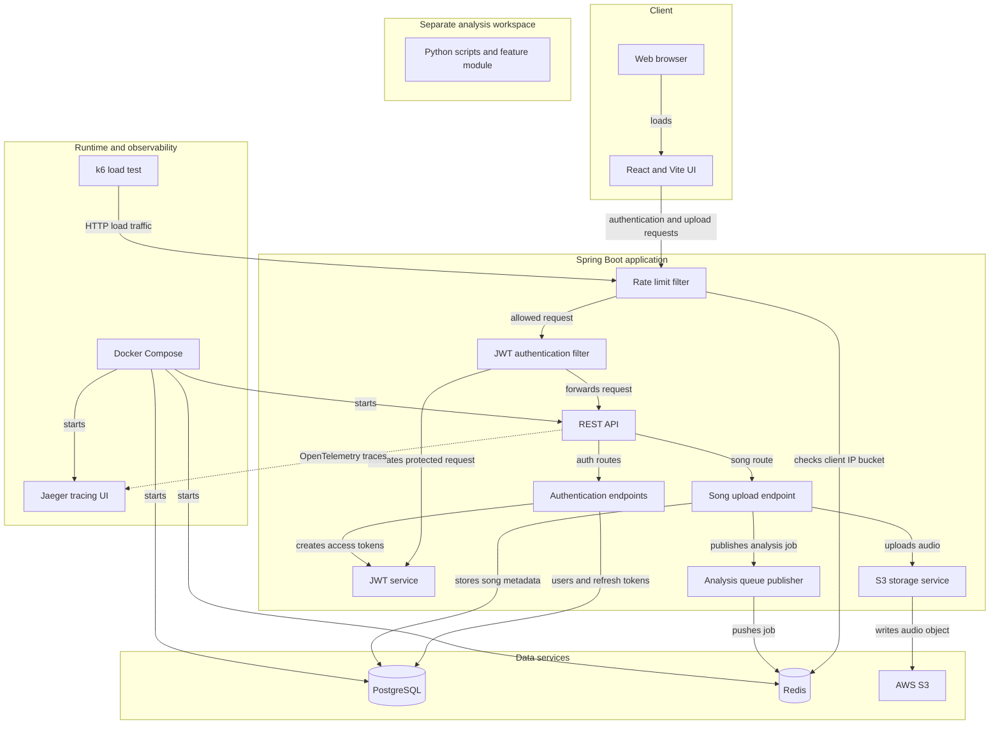
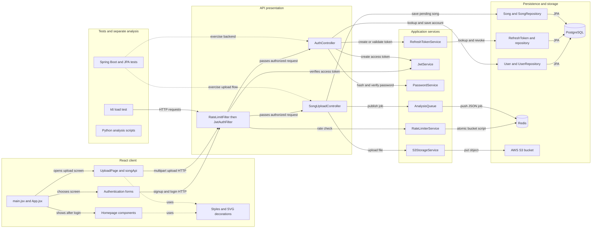

# Architecture Diagram

Sandinify is a small music application repository with a React client, a Spring Boot API, and a separate Python audio-analysis workspace. The API implements authentication, song uploads, storage, and job publication; the visible catalog and audio-analysis processing are not yet connected end-to-end.

## Application Architecture

<!-- mermaid-checked: no \n, no em-dash/en-dash, no {} in labels, subgraphs are id["label"], arrows are -->|"label"|, all subgraphs closed by end, ids unique -->

### Technology Stack Summary

| Layer | Technology | Version | Purpose |
|---|---|---|---|
| Browser UI | React | 18.3.1 | Login, homepage, and song-upload screens |
| Frontend tooling | Vite | 6.4.4 | Local development server and production bundling |
| API | Java and Spring Boot | Java 25; Spring Boot 4.1.1 | REST endpoints, filters, dependency injection, and JPA |
| Relational database | PostgreSQL | 16 in Compose | User, refresh-token, and song metadata persistence |
| Shared state and queue | Redis | 7 in Compose | Rate-limit buckets and pending analysis jobs |
| Object storage | AWS S3 SDK | SDK 2.20.0 | Stores uploaded audio files |
| Password hashing | Spring Security Crypto | Managed by Spring Boot | Argon2 password hashing and verification |
| Token support | Nimbus JOSE JWT | 9.40 | Signed JWT access tokens |
| Audio analysis | Python libraries | Unpinned in requirements | Intended offline feature extraction and model training; scripts are empty |
| Tracing | OpenTelemetry Java agent and annotations | Agent downloaded at image build; annotations 2.9.0 | Exports API traces to Jaeger |
| Test and load tools | JUnit, Spring test, k6 | Managed / script-based | Backend tests and HTTP load generation |
| Runtime | Docker Compose | Compose file | Runs the API, PostgreSQL, Redis, and Jaeger |

### Data Storage & External Services

PostgreSQL stores user credentials as password hashes, refresh-token hashes and revocation state, and song metadata. Uploaded audio bytes go to AWS S3 under generated object keys. Redis serves two distinct purposes: atomic token-bucket rate limiting and a list containing serialized pending song-analysis jobs. Jaeger receives traces from the instrumented backend. The Python workspace is not currently wired to the queue, S3, or API, and there is no analysis worker in the repository to consume jobs.

### Key Architectural Decisions

- The API separates web controllers, services, repositories, and JPA entities; Spring Data derives repository operations from method names.
- Redis executes the rate-limit token-bucket update atomically with a Lua script, allowing counters to be shared across backend instances.
- Song uploads store the audio object first, persist its metadata with `PENDING` status, and then publish a Redis job. Queue failure is logged while the saved row remains pending.

## Component Relationships

<!-- mermaid-checked: no \n, no em-dash/en-dash, no {} in labels, subgraphs are id["label"], arrows are -->|"label"|, all subgraphs closed by end, ids unique -->

### Component Inventory

| Component | Layer | Type | Responsibility |
|---|---|---|---|
| `main.jsx` and `App.jsx` | Client | React entry and screen router | Starts React; keeps the authenticated username and switches between auth, home, and upload screens |
| Authentication forms | Client | React form component | Submits signup and login requests, reports outcomes, and stores returned tokens |
| Homepage components | Client | React presentation components | Renders sample songs, placeholder playlists, profile controls, and upload navigation |
| `UploadPage` and `songApi` | Client | React page and API helper | Validates the selected extension, sends multipart upload, refreshes access token once after 401, and displays status |
| `RateLimitFilter` | Infrastructure | Servlet filter | Checks every non-OPTIONS request against a Redis token bucket before continuing |
| `JwtAuthFilter` | Infrastructure | Servlet filter | Allows public auth routes, validates bearer tokens on other API routes, and attaches the username |
| `AuthController` | Presentation | REST controller | Implements signup, login, refresh, logout, and protected `/api/me` routes |
| `SongUploadController` | Presentation | REST controller | Validates upload metadata and coordinates S3, PostgreSQL, and queue publication |
| `RateLimiterService` | Business / infrastructure | Redis service | Runs the atomic token-bucket Lua script |
| `PasswordService` | Business logic | Security service | Hashes passwords with Argon2 and compares submitted passwords |
| `JwtService` | Business logic | Token service | Signs 15-minute HS256 access tokens and verifies their signature and expiration |
| `RefreshTokenService` | Business logic | Token service | Creates random seven-day refresh tokens, stores only hashes, validates expiry, and revokes tokens |
| `S3StorageService` | Infrastructure | AWS adapter | Uploads a multipart file to a generated S3 key |
| `AnalysisQueue` | Infrastructure | Redis publisher | Pushes a JSON job containing song ID and S3 key onto a Redis list |
| `User`, `RefreshToken`, `Song` and repositories | Data access | JPA entities and repositories | Map application records to PostgreSQL and provide persistence operations |
| Python audio-analysis files | Separate workspace | Python scripts and module | Intended feature extraction and training area; all current `.py` files are empty |

## Codebase Walkthrough

This inventory explains the authored source and the configuration that runs or tests it. Generated Maven `target` outputs and the npm lockfile are not repeated as application logic.

### Frontend

| File | How it works |
|---|---|
| `user_management/frontend/index.html` | Provides the browser document, root element, and module entry script for Vite. |
| `user_management/frontend/src/main.jsx` | Defines the root React component. It renders authentication until a username is supplied, then chooses the homepage or upload screen based on local component state. |
| `user_management/frontend/src/App.jsx` | Implements the signup and login forms. It posts credentials to the API, handles HTTP and network feedback, stores access and refresh tokens in browser local storage, and calls the parent callback on success. It also contains older refresh/authenticated-fetch helpers that are not used by the upload flow. |
| `user_management/frontend/src/api/songApi.js` | Builds the multipart song request, attaches the stored bearer token, tries a refresh and one retry after HTTP 401, and converts unsuccessful responses into user-facing errors. Its API base URL can be set with `VITE_API_BASE_URL`. |
| `user_management/frontend/src/home_page/Homepage.jsx` | Composes the header, sidebar, and song cards. The three displayed songs are hard-coded sample data rather than API results. |
| `user_management/frontend/src/home_page/Header.jsx` | Renders the Sandinify banner, navigation tabs, search controls, username, and upload button. Most controls are visual placeholders. |
| `user_management/frontend/src/home_page/Sidebar.jsx` | Renders a fixed list of sample playlists and decoration; it does not fetch playlist data. |
| `user_management/frontend/src/home_page/Songcard.jsx` | Displays the fields of a song object as a card. Playback, playlist, and share buttons currently have no behavior. |
| `user_management/frontend/src/home_page/Decor.jsx` | Defines reusable SVG `Pudding` and `Sparkle` graphics in React. |
| `user_management/frontend/src/home_page/Styles.jsx` | Exports shared color and inline-style objects and generates CSS backgrounds for polka dots and piano keys. |
| `user_management/frontend/src/home_page/UploadPage.jsx` | Holds upload-form state, checks the filename extension, requires title, artist, and file, calls `uploadSong`, and displays loading/success/error feedback. The artist field is sent as the API's `username` form parameter. |
| `user_management/frontend/src/home_page/UploadPage.css` | Styles the browser's native file-selection button. The rest of the upload page styling is defined in `UploadPage.jsx`. |
| `user_management/frontend/package.json` | Declares React, React DOM, Vite, the React plugin, and development/build/preview commands. |

### Backend application source

For the rows below, `.../` in a Java path means `user_management/backend/server/sandinify/src/main/java/com/example/sandinify/`.

| File | How it works |
|---|---|
| `user_management/backend/server/sandinify/src/main/java/com/example/sandinify/SandinifyApplication.java` | Spring Boot entry point; starts component scanning, auto-configuration, and the embedded web server. |
| `.../auth/api/AuthController.java` | Maps `/api/signup`, `/api/login`, `/api/refresh`, `/api/logout`, and `/api/me`. It validates required account fields, persists password hashes, and coordinates access and refresh token services. |
| `.../JwtAuthFilter.java` | Runs after the rate-limit filter. It bypasses OPTIONS and public auth paths, verifies bearer tokens on other `/api/` paths, and returns 401 or attaches the username to the request. |
| `.../JwtService.java` | Builds signed HS256 tokens with username subject and 15-minute expiration, and rejects malformed, unsigned, or expired tokens. |
| `.../PasswordService.java` | Uses Spring Security's Argon2 encoder for password hashing and verification. |
| `.../RateLimiterService.java` | Runs a Redis Lua token-bucket script using Redis time, stores token count and timestamp per key, and expires inactive buckets. |
| `.../RateLimitFilter.java` | Applies the limiter to requests by client IP, returns 429 when the bucket is empty, and fails open if Redis processing throws an exception. |
| `.../RefreshToken.java` | JPA entity for a refresh-token hash, user ID, expiration timestamp, and revocation flag. |
| `.../RefreshTokenRepository.java` | Spring Data JPA repository; provides standard CRUD and a derived lookup by token hash. |
| `.../RefreshTokenService.java` | Generates random refresh secrets for clients, stores only SHA-256 hashes, checks expiry and revocation, and marks tokens revoked on logout. |
| `.../User.java` | JPA mapping for the unique username and password-hash columns in the `users` table. |
| `.../UserRepository.java` | Spring Data JPA interface with username existence and lookup queries. |
| `.../songs/Song.java` | JPA mapping for song title, artist, unique S3 key, processing status, optional analysis fields, failure reason, and creation time. New rows start at `PENDING`. |
| `.../songs/SongRepository.java` | Standard Spring Data JPA CRUD repository for `Song`. |
| `.../songs/SongStatus.java` | Defines the lifecycle labels `PENDING`, `PROCESSING`, `READY`, and `FAILED`; no in-repository worker advances them. |
| `.../songs/api/SongUploadController.java` | Handles multipart `POST /api/songs/upload`; checks required fields, uploads bytes to S3, stores a pending song row, then publishes an analysis job. |
| `.../songs/api/S3StorageService.java` | Constructs an AWS S3 client from configuration and writes each upload under a random `songs/<uuid>.mp3` key. |
| `.../songs/api/AnalysisQueue.java` | Serializes song ID and S3 key into JSON and pushes it onto the Redis `queue:song-analysis` list. No consumer is present. |

### Backend tests and runtime files

| File | How it works |
|---|---|
| `.../src/test/java/com/example/sandinify/SandinifyApplicationTests.java` | Spring integration tests for authentication, token refresh/revocation, and protected routes using MockMvc; the rate limiter is mocked so Redis is not needed. |
| `.../src/test/java/com/example/sandinify/songs/api/AnalysisQueueTest.java` | Verifies that publishing creates a JSON Redis-list item with the expected song ID and S3 key. |
| `.../src/test/java/com/example/sandinify/songs/api/SongUploadControllerTest.java` | Verifies successful upload ordering, metadata persistence, pending state, and queue publication with mocked dependencies. |
| `.../src/test/java/com/example/sandinify/songs/SongRepositoryTest.java` | Uses a JPA test context to save and read a song row and check its initial status and creation timestamp. |
| `.../src/test/resources/application-test.properties` | Configures the test datasource as an in-memory H2 database. |
| `user_management/backend/server/sandinify/pom.xml` | Declares Java 25, Spring Boot, web, JPA, Redis, PostgreSQL, S3, JWT, crypto, OpenTelemetry, and test dependencies plus the Spring Boot Maven plugin. |
| `.../src/main/resources/application.properties` | Configures application name, PostgreSQL/JPA settings, optional local secret-property imports, multipart limits, and S3 environment-variable bindings. |
| `user_management/backend/server/sandinify/Dockerfile` | Builds a Java 25 runtime image from the Maven JAR, downloads the OpenTelemetry Java agent, and starts the instrumented service on port 8080. |
| `user_management/backend/server/sandinify/docker-compose.yml` | Starts PostgreSQL, Redis, Jaeger, and the backend; injects runtime environment variables and waits for PostgreSQL health. It does not start the React frontend or a Python worker. |
| `user_management/backend/server/sandinify/loadtest.js` | Defines k6 scenarios for rate limiting, login, signup, `/api/me`, and token refresh; setup creates a test account and provides tokens to scenarios. |
| `user_management/backend/server/sandinify/mvnw` and `mvnw.cmd` | Unix and Windows Maven wrapper launchers for running Maven without a separate global Maven install. |
| `user_management/backend/server/sandinify/.mvn/wrapper/maven-wrapper.properties` | Selects Maven distribution details used by the wrapper. |
| `user_management/backend/server/sandinify/.gitignore` and `.gitattributes` | Exclude local/build files and define repository text handling for the backend project. |
| `.github/workflows/ci.yml` | Runs the Maven test suite on pushes and pull requests using Temurin Java 25 and test-only cloud environment values. |
| `.github/copilot-instructions.md` | Workspace-specific instructions for coding agents; it does not affect the running application. |
| `.github/modernize/java-upgrade/hooks/scripts/recordToolUse.ps1` | Reads a tool-call event from standard input, filters for terminal and modernization tools, and appends the event as JSONL under the hooks directory. |
| `.github/modernize/java-upgrade/hooks/scripts/recordToolUse.sh` | Bash counterpart to the PowerShell recorder; it filters the same event types and appends JSONL for the modernization extension. |
| `.github/modernize/java-upgrade/.gitignore` | Excludes generated or session-specific modernization hook output. |
| `user_management/backend/server/sandinify/.vscode/settings.json` | Sets the workspace Java null-analysis preference for VS Code. |
| `.idea/` project files | IntelliJ project/compiler/module/workspace metadata; they affect local IDE setup, not the application runtime. |

### Audio-analysis workspace

| File or directory | How it works |
|---|---|
| `audio_analysis/shared/__init__.py` | Empty package marker. |
| `audio_analysis/shared/features.py` | Empty placeholder for shared audio feature logic. |
| `audio_analysis/training/build_matrix.py` | Empty placeholder; no feature-matrix builder is implemented. |
| `audio_analysis/training/build_thresholds.py` | Empty placeholder; no threshold-generation logic is implemented. |
| `audio_analysis/training/explore.py` | Empty placeholder for exploratory analysis. |
| `audio_analysis/training/extract.py` | Empty placeholder; no audio extraction pipeline is implemented. |
| `audio_analysis/training/inspect_deam.py` | Empty placeholder for inspecting a DEAM dataset. |
| `audio_analysis/training/predict_one.py` | Empty placeholder; no single-file prediction flow is implemented. |
| `audio_analysis/training/train.py` | Empty placeholder; no model training pipeline is implemented. |
| `audio_analysis/training/requirements.txt` | Lists Essentia, NumPy, pandas, scikit-learn, and XGBoost without version pins. |
| `audio_analysis/models/` | Empty directory; no trained model files are present. |

### Documentation, assets, and repository configuration

| File | How it works |
|---|---|
| `README.md` | Project overview, auth design, API routes, operational setup, test/load-test notes, upload design references, and planned features. Some statements describe intended architecture; this walkthrough reflects checked-in code. |
| `user_management/Homepage.md` | Early frontend notes describing placeholder pages and component intentions. |
| `user_management/User_Auth.md` | Authentication and frontend/backend design notes, including embedded diagrams. |
| `User_Auth_Diagram.png` and `image.png` | Static visual assets referenced by project documentation and the README. |
| `.gitignore` | Excludes IDE files, frontend dependencies/build output, local Python environments/data, models, and environment files. |
| `user_management/frontend/package-lock.json` | Locks the npm dependency tree for reproducible installs; it is generated package metadata, not handwritten application logic. |
| `user_management/backend/server/sandinify/HELP.md` | Maven-generated help and Spring documentation links; it does not implement application behavior. |

## End-to-End Flows

1. **Browser startup:** Vite serves `index.html`; `main.jsx` mounts the React root. Until the user signs in, `App.jsx` shows the authentication forms. After success, `main.jsx` holds the username in memory and shows the homepage.
2. **Signup or login:** The form posts credentials to the Spring API. `RateLimitFilter` checks Redis first. The auth controller then reads or writes the user record, `PasswordService` hashes or verifies the password, `JwtService` creates an access token, and `RefreshTokenService` creates a refresh token whose hash is stored in PostgreSQL.
3. **Song upload:** The upload page builds a multipart request. The API rate-limits it, checks the access token, validates the title/artist/file metadata, uploads audio to S3, stores a `PENDING` song row in PostgreSQL, and pushes a job onto Redis. A Redis consumer would need to fetch and analyze that job, but none is implemented.
4. **Homepage display:** The React homepage currently renders local sample objects and placeholder playlists. It does not query the song table, stream S3 objects, or trigger playback.
5. **Audio analysis:** The Python directory has dependency names and empty `.py` placeholders only. No feature extraction, model training, prediction, or worker execution occurs in the current application.

## Current Behavior and Boundaries

- Authentication is implemented in the backend. The React app keeps the username in React state and stores bearer and refresh tokens in local storage; refresh support exists in both the auth component and the upload API helper, but the latter is the path used by song uploads.
- The authentication form calls a hard-coded local API URL, while `songApi.js` supports `VITE_API_BASE_URL`; deployments outside localhost need the auth URL made configurable too.
- The homepage, playlists, search, playback, and most navigation actions are presentation-only placeholders. They do not retrieve or play songs.
- Uploading writes the audio object to S3, writes a `PENDING` metadata row to PostgreSQL, and publishes a Redis list item. The upload page's success text currently says song details are not saved yet, but the backend does save them.
- No Redis queue consumer or Python analysis integration exists. All current Python source files are zero bytes, and the models directory has no model artifact.
- JPA schema creation/update is configured through `ddl-auto=update`; no application migration scripts are present in the listed source tree.
- Local environment/secret files are ignored and were not copied into this document. Keep their values out of source control and rotate any credentials that have been exposed.
- On case-sensitive systems, verify the frontend import capitalization: `Homepage.jsx` imports `./styles` and `./SongCard`, while the checked-in files are named `Styles.jsx` and `Songcard.jsx`. Windows development may resolve these, but Linux CI or deployment can fail.
