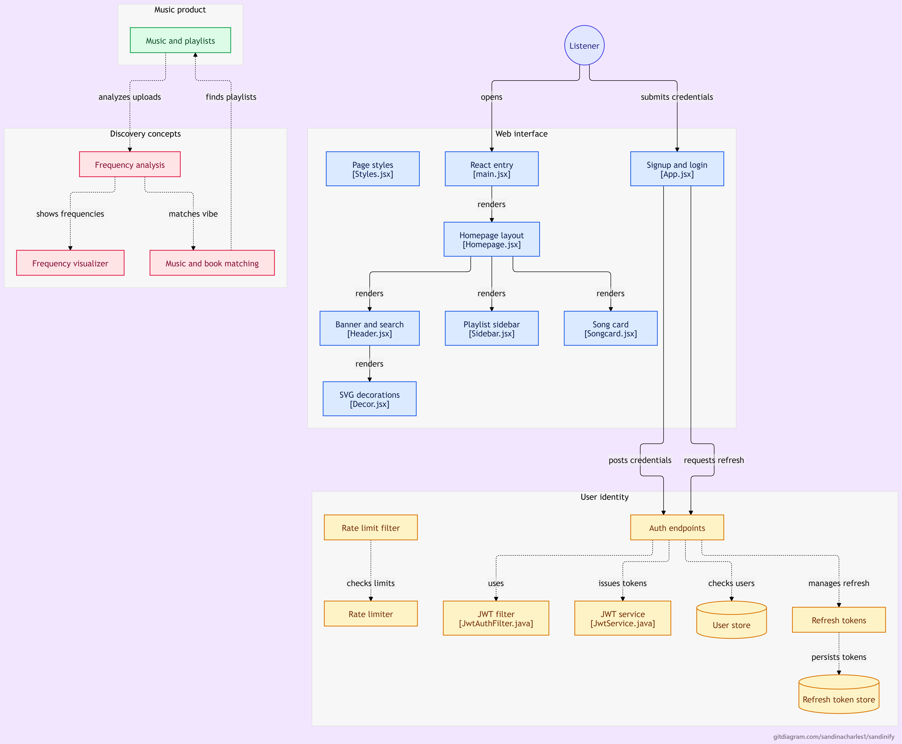

# Sandinify [](https://github.com/sandinacharles1/Sandinify/actions/workflows/ci.yml)

**Sandinify** is a personal project I'm building to learn how backend systems and system design work. It is a music application heavily inspired by Spotify, but with a unique twist that lets you analyze the actual frequencies of a song and find matching books!
## Table of Contents
* [Homepage Preview](#homepage-preview)
* [Sandinify User Authentication Section](#sandinify-user-authentication-section)
  * [Features](#features)
  * [Tech Stack](#tech-stack)
  * [API Endpoints](#api-endpoints)
  * [Architecture](#architecture)
    * [Project Structure](#project-structure)
  * [Design Decisions](#design-decisions)
    * [Rate limiter: token bucket](#rate-limiter-token-bucket)
    * [Why Redis?](#why-redis)
    * [Why Lua for atomicity?](#why-lua-for-atomicity)
    * [Why not handle it in Java?](#why-not-handle-it-in-java)
    * [Failure behavior](#failure-behavior)
    * [Authentication](#authentication)
  * [Unit Testing](#testing)
  * [Continuous Integration](#continuous-integration)
  * [Load Testing and Distributed Tracing](#load-testing-and-distributed-tracing)
    * [Initial results](#initial-results)
  * [Getting Started](#getting-started)
    * [Prerequisites](#prerequisites)
    * [Run](#run)
    * [Run the tests](#run-the-tests)
    * [Run the load test](#run-the-load-test)
*  [What I Learned](#what-i-learned)
* [Running Multiple Instances Behind a Load Balancer](#running-multiple-instances-behind-a-load-balancer)
* [Song Upload System Design](#song-upload-system-design)
  * [Upload System Design (Emphasis on ML)](#current-upload-design)
  * [Upload System Design (Emphasis on transcoding)](#extra-upload-design)
  * [Feature Extraction System Design](#feature-extraction-design)
*  [Song Retrieval System Design](#song-retrieval-system-design)
* [Upcoming Features](#upcoming-features)

---
## Homepage Preview


# Sandinify User Authentication Section

A Spring Boot backend for user authentication, built with the scalability and observability practices of a production service: a Redis-backed distributed rate limiter, JWT access and refresh tokens, integration tests, and load testing with distributed tracing.

## Features

- **User identity:** signup, login, and a protected `/api/me` endpoint
- **Token-based auth:** short-lived JWT access tokens and revocable refresh tokens
- **Distributed rate limiting:** token bucket algorithm in Redis, enforced by a servlet filter
- **Observability:** OpenTelemetry spans visualized in Jaeger
- **Load tested:** k6 scripts that exercise every endpoint
- **Containerized:** one command starts the app, PostgreSQL, and Redis

## Tech Stack

| Area | Tools |
|---|---|
| Backend | Java, Spring Boot, Spring Data JPA |
| Database | PostgreSQL |
| Cache / rate limiting | Redis, Lua |
| Auth | JWT (HMAC-SHA256), hashed refresh tokens |
| Testing | JUnit 5, MockMvc, Mockito |
| Load testing / tracing | k6, OpenTelemetry, Jaeger |
| Infrastructure | Docker, Docker Compose |

## API Endpoints

| Method | Endpoint | Description | Success | Errors |
|---|---|---|---|---|
| POST | `/api/signup` | Create an account, returns tokens | 201 | 400 blank fields, 409 username taken |
| POST | `/api/login` | Log in, returns tokens | 200 | 401 invalid credentials |
| GET | `/api/me` | Current user (requires access token) | 200 | 401 invalid or expired token |
| POST | `/api/refresh` | Exchange a refresh token for a new access token | 200 | 401 session expired |
| POST | `/api/logout` | Revoke a refresh token | 200 | |

Any endpoint can return **429** when the caller exceeds the rate limit.

## Architecture

```
Request
   |
   v
RateLimitFilter ----> RateLimiterService ----> Redis (Lua token bucket)
   |
   v
JwtAuthFilter (verifies access token on protected routes)
   |
   +--> auth.api.AuthController ----> Auth Services ----> Repositories ----> PostgreSQL
   |
   +--> songs.api.SongUploadController ----> S3StorageService + SongRepository ----> AWS S3 + PostgreSQL
```

### Project Structure

| File | Purpose |
|---|---|
| `RateLimiterService.java` | Token bucket logic, executed as an atomic Lua script in Redis |
| `RateLimitFilter.java` | Runs first on every request; identifies the client by IP and blocks when over the limit |
| `auth/api/AuthController.java` | Authentication REST endpoints; validates input and returns the appropriate HTTP status |
| `songs/api/SongUploadController.java` | Uploads a song to S3 and saves its title, artist, S3 URL, and optional genre, mood, and tags |
| `songs/Song.java` / `songs/SongRepository.java` | JPA mapping and repository for song metadata in PostgreSQL |
| `User.java` / `UserRepository.java` | JPA entity and repository for the users table |
| `RefreshToken.java` / `RefreshTokenRepository.java` / `RefreshTokenService.java` | Refresh token persistence, plus create, hash, validate, and revoke |
| `JwtService.java` | Creates and verifies signed JWT access tokens |
| `JwtAuthFilter.java` | Verifies the access token on protected routes |
| `SandinifyApplicationTests.java` | Integration test suite |
| `loadtest.js` | k6 load test |

Hibernate's `ddl-auto=update` creates or updates the mapped PostgreSQL tables, including `songs`, when the application starts. Docker Compose provisions the PostgreSQL database itself (`sandinify`); when running against a separately installed PostgreSQL server, create that database first.

## Design Decisions

### Rate limiter: token bucket

Each client gets a bucket of tokens. Every request costs one token, and tokens refill at a steady rate. The refill is calculated lazily when a request arrives, so there is no background timer. An empty bucket means the request is rejected with a `429`.

**Why token bucket?** Real traffic is bursty. Token bucket allows short bursts up to the bucket's capacity while still capping the average rate over time. It stores only two values per client (tokens and last timestamp), and it avoids the boundary problem of fixed windows.

### Why Redis?

- State is **shared across app instances**, so counts stay correct when the service scales out
- In-memory and fast, which matters because the check runs on every request
- Built-in **TTL/expiry** cleans up idle buckets automatically
- Avoids hitting the main database on every request
- Tradeoff: one extra network round trip per request

### Why Lua for atomicity?

Redis executes commands one at a time, but a rate limit check has several steps: read the bucket, refill it, decide, write it back. Another request could slip in between those steps and both would see the same token count. A Lua script runs as a single unit inside Redis, so the whole check-and-update cannot be interleaved. It also takes one round trip instead of several and uses Redis's own clock, so all app servers agree on the time.

**Tradeoffs:** The script is a string, so it is harder to read, test, and debug. A long script would block Redis, so this one is kept short.

### Why not handle it in Java?

Java locks like `synchronized` only protect a single JVM. With multiple server instances, each has its own lock and none can see the others. Since Sandinify is designed like a scalable service, the coordination has to live outside the app, in Redis.

### Failure behavior

If Redis is unavailable, the filter **fails open** and lets the request through, since blocking all users because of a limiter outage is worse than briefly allowing extra traffic.

## Authentication

This application utilizes a secure, split-state authentication design to balance performance, strict data secrecy, and user experience. 

*   **Passwords are Hashed:** Credentials are never stored in plain text.
*   **Enumeration Prevention:** The login endpoint returns the exact same generic error for an incorrect password as it does for an unknown user, preventing attackers from harvesting valid usernames.

---

### 1. Stateless Access Tokens (JWT)
Access tokens are short-lived, self-contained JSON Web Tokens (JWTs) that expire exactly **15 minutes** after issuance. Because they are self-contained, the backend does not perform database lookups to authorize incoming requests.

*   **Token Structure & Claims:** The token consists of three period-separated segments: `header.payload.signature`. The payload contains explicit lifecycle claims:
    *   `sub`: The authenticated username.
    *   `iat`: The exact Unix timestamp of token creation.
    *   `exp`: The exact Unix timestamp marking token death.
*   **Symmetric Verification (Tamper Proofing):** Every inbound request passing through `JwtAuthFilter` triggers an on-demand cryptographic signature verification using a private key:
    *Signature = HMAC-SHA256(Base64URL(Header) + "." + Base64URL(Payload), SecretKey)*
*   **Integrity Enforcement:** If a malicious client modifies the payload (such as altering the `exp` timestamp to skip expiration), the freshly calculated hash will mismatch the signature. The filter catches this instantly via `jwt.verify()` and drops the request with a `401 Unauthorized` response before it ever hits your application logic.

---

### 2. State-Backed Refresh Tokens
To maximize security without requiring users to constantly retype their credentials, long-lived access tokens are avoided. Instead, when the 15-minute access window dies, the client relies on a long-lived `RefreshToken`.

*   **Storage & Secrecy:** Unlike stateless access tokens, refresh tokens are stored securely as non-reversible hashes directly inside the database.
*   **Sliding Sessions:** When the frontend receives a `401 Unauthorized` response due to an expired access token, it intercepts the error and quietly submits the refresh token to `/api/refresh` to fetch a new access token.
*   **Revocation Support:** Because the backend explicitly matches incoming refresh tokens against database records, access can be revoked immediately. When a user calls `/api/logout`, their refresh token is invalidated or purged from the database, preventing any future access token renewals.

## Testing

`SandinifyApplicationTests` contains **12 integration tests** that send requests through the full stack with `MockMvc`:

1. Signup succeeds and returns tokens
2. Duplicate signup returns 409
3. Blank fields return 400
4. Login with correct credentials returns tokens
5. Login with wrong password returns 401
6. Login with unknown user returns 401
7. `/me` with a valid token returns 200
8. `/me` with no token returns 401
9. `/me` with a tampered token returns 401
10. Refresh with a valid refresh token returns a new access token
11. Refresh with a fake token returns 401
12. After logout, the refresh token is rejected

The suite uses `@Transactional` so each test's database changes are rolled back, a test-only JWT secret, and a mocked rate limiter so the tests do not depend on Redis.
## Continuous Integration

Every push runs the test suite automatically on a clean GitHub-hosted machine, so a passing result doesn't depend on anything installed on my laptop. The workflow lives in `.github/workflows/ci.yml`.

### How the workflow works

GitHub starts a fresh, empty Ubuntu virtual machine for each run and discards it afterward. The workflow builds up everything the tests need, in order:

| Step | What it does | Why it's needed |
|---|---|---|
| `actions/checkout` | Clones the repo onto the VM | The VM starts with no code |
| `actions/setup-java` (Temurin 25, `cache: maven`) | Installs Java 25 and caches Maven downloads | The VM has no Java, and the version must match `pom.xml`. Caching avoids re-downloading dependencies on every run |
| `./mvnw test` with `working-directory` | Runs every test in `src/test/java` | The Maven project is in `backend`, not the repo root |

The workflow triggers on `push` and `pull_request`, so a failing change shows a red check before it is merged. It runs the integration and unit tests only. The k6 load tests are not part of CI, because they need a running app and real traffic.

### Making the tests run on a blank machine

Passing locally and passing in CI were not the same thing. Three problems showed up, and each had a different fix:

1. **`mvnw` was not executable.** The run failed with `Permission denied` (exit code 126). Files committed from Windows lose the Linux executable bit. Fixed with `git update-index --chmod=+x` on the script, which fixes it for anyone who clones the repo, not just CI.
2. **Missing config values.** `application.properties` references `${AWS_BUCKET_NAME}` and three other AWS variables that only exist on my machine. Because `@SpringBootTest` boots the whole app, an unresolved placeholder crashes startup and fails every test. The workflow sets fake values under `env:`. No test calls S3, so the values are never used, and they are safe to keep in a public file. Real credentials are never committed.
3. **No database on the VM.** The main config points at Postgres on `localhost:5432`, which doesn't exist in CI. Tests use a `test` profile (`src/test/resources/application-test.properties`) that switches to H2, a small in-memory database that needs no installation. The profile only overrides the datasource, so all other settings still apply. `SandinifyApplicationTests` activates it with `@ActiveProfiles("test")`.

### Tradeoff

H2 is not PostgreSQL, so a Postgres-specific SQL feature could behave differently in tests than in production. Nothing in the project depends on one today. If that changes, the alternative is a `services: postgres:` container in the workflow, which runs a real PostgreSQL next to the test job.

## Load Testing and Distributed Tracing

Load tests are written in **k6** (`loadtest.js`). The setup creates a test user, then each endpoint (signup, login, `/me`, refresh) is exercised in its own function to keep scenarios decoupled. Password hashing is separated into its own step so its cost can be measured on its own.

Key methods are annotated with OpenTelemetry's `@WithSpan`, which automatically records how long each one takes. The traces are exported to **Jaeger**, so a slow request can be broken down into its parts the way an on-call engineer would debug it.

### Initial results

| Scenario | Result |
|---|---|
| Rate limiter | 5,887 of 6,000 requests sent in rapid bursts were rejected with 429, as expected once the bucket emptied |
| Login | 100% success |
| Signup | 100% success |
| `/me` (access token check) | 100% success |
| Refresh | 100% success |

<p align="center">
  
</p>

<table>
  <tr>
    <td></td>
    <td></td>
  </tr>
  <tr>
    <td></td>
    <td></td>
  </tr>
  <tr>
    <td></td>
    <td></td>
  </tr>
</table>


## Getting Started

### Prerequisites

- Docker and Docker Compose

### Run

```bash
git clone https://github.com/<sandinacharles1>/sandinify.git
cd sandinify
cd backend
docker compose up --build
```

Docker Compose starts the Spring Boot app, PostgreSQL, and Redis. The Dockerfile packages the app and downloads the OpenTelemetry Java agent for the JVM. Database credentials and the JWT secret are read from environment variables, never hardcoded.

### Run the tests

```bash
cd backend
./mvnw test
```

### Run the frontend

```bash
cd frontend
npm ci
npm run dev
```

### Run the load test

```bash
cd backend
k6 run loadtest.js
```

## What I Learned

While writing the integration tests, every test was failing and the cause was not obvious. Instead of trying random fixes, I narrowed the problem down: since all tests failed, I suspected shared configuration rather than individual logic. I confirmed the app worked outside the test environment by creating an account manually, which isolated the issue to the test setup. Reading the logs more carefully showed that the test environment was not loading configuration properties correctly and that the JWT secret property was referenced with the wrong case. The main lesson was to gather evidence and change my approach when something isn't working, instead of repeating the same fix.

# Running Multiple Instances Behind a Load Balancer

To test how Sandinify handles multiple backend instances—specifically how shared Redis rate-limiting, JWT authentication, and distributed tracing behave under load—I moved the backend from a single Docker Compose container to a local Kubernetes cluster using **kind** and an **F5 NGINX Ingress Controller**.

## Request Flow Architecture

```text
k6 / Browser (localhost:8081)
       │
       ▼
kind Node Port Mapping (Host 8081 ──▶ Node 80)
       │
       ▼
F5 NGINX Ingress Controller (Routes /api for host: localhost)
       │
       ▼
sandinify Service (Stable internal IP & load balancer)
       │
       ├──▶ App Pod 1 ──┐
       │                ├──▶ Redis (Shared rate-limit buckets)
       └──▶ App Pod 2 ──┼──▶ PostgreSQL (PersistentVolumeClaim)
                        └──▶ Jaeger v2.23.0 (OTLP HTTP traces)
```

---

## Chronological Setup, Changes & Engineering Decisions

### Step 1: Make the Application Container-Portable
> **What this means:** Packaging the app so it builds itself inside Docker and gets its database/frontend addresses from outside settings rather than hardcoded `localhost` links.

* **Multi-stage `Dockerfile`:** Replaced the single-stage Dockerfile (which relied on a pre-built `target/*.jar` from my laptop) with a two-stage build. Stage 1 compiles and packages the JAR inside a container with Maven and Java 25; Stage 2 copies *only* the finished JAR into a lightweight Java runtime image (leaving build tools and source code behind). Added `.dockerignore` to keep `.git`, `target/`, and `secret.properties` out of the build context.
* **Environment-driven hosts and CORS:** Inside a container, `localhost` means *that container itself*, not my laptop or another container. I updated `application.properties` so `SPRING_DATASOURCE_URL` and `SPRING_DATA_REDIS_HOST` are injected via environment variables (keeping localhost fallbacks for local development). I also centralized the hardcoded `http://localhost:5173` **CORS** (Cross-Origin Resource Sharing, the browser rule controlling which frontend URL can call the backend) origin into a single `app.cors.allowed-origin` property across `AuthController`, `SongUploadController`, `JwtAuthFilter`, and `RateLimitFilter` so early error responses respect the configured frontend address.

### Step 2: Provision the Local Cluster (`k8s/kind-config.yaml`)
> **What this means:** Building the empty Kubernetes environment inside Docker on my laptop and wiring up a port (`8081`) so outside traffic can reach inside it.

* **Cluster & port mapping:** Installed **kind** (Kubernetes IN Docker, a tool that runs a local Kubernetes cluster inside Docker containers) and created `k8s/kind-config.yaml`. Use this path with kind's `--config` option when creating the cluster. The file defines a single `control-plane` **node** (the virtual machine/container that manages the cluster) with the label `ingress-ready=true` (a marker telling the ingress controller it can run on this node). I configured `extraPortMappings` to connect laptop port `8081` to container port `80`, creating an entry doorway without colliding with port `8080`.
* **Image loading:** Built `sandinify:kind` and copied it directly into the cluster (`kind load docker-image sandinify:kind --name sandinify`), because kind nodes have their own isolated image storage and cannot see images sitting in my laptop's regular Docker list.

### Step 3: Deploy Workloads & Isolate Secrets (`kind-workloads.yaml` & `apply-kind.ps1`)
> **What this means:** Starting my actual programs (two copies of the backend, Postgres, and Redis) inside the empty cluster and splitting passwords into separate, need-to-know buckets instead of one giant shared list.

* **Kubernetes manifests (`k8s/kind-workloads.yaml`):** Created a dedicated `sandinify` **namespace** (an isolated folder inside the cluster to group this project's resources) containing:
  * **PostgreSQL:** A **Deployment** (instructions telling Kubernetes to keep a specific container running), a **Service** (a permanent internal hostname so other apps can find Postgres even if its Pod restarts and changes IP addresses), and a `1Gi` **PersistentVolumeClaim (PVC)** (a reserved virtual hard drive so database records survive container restarts).
  * **Redis:** A Deployment and Service reachable internally at `redis:6379`.
  * **Sandinify Backend:** A Deployment with `replicas: 2` (two identical **Pods**, the smallest deployable units wrapping my app containers), **probes** (automated health checks verifying the app is alive and ready for traffic), **init containers** (helper containers that run first and wait for Postgres and Redis to answer before starting the app), and an internal `ClusterIP` Service (`sandinify`) that spreads internal requests across both Pods.
* **Scoped Secret injection (`k8s/apply-kind.ps1`):** Removed placeholder credentials from tracked YAML files. Wrote a PowerShell script that extracts only the six required keys from my gitignored `.env` into two isolated Kubernetes **Secrets** (objects that store sensitive configuration and pass it into Pods as environment variables)—`sandinify-db-secrets` for Postgres and `sandinify-app-secrets` for JWT and AWS keys—so each workload only receives the keys it explicitly references.

### Step 4: Configure Ingress Load Balancing, Observability & Load Tests
> **What this means:** Setting up the cluster's front-door traffic router (Ingress) to balance requests across both app Pods, connecting Jaeger to record timing traces, and aiming k6 load tests at the cluster.

* **NGINX Ingress (`k8s/install-kind-ingress.ps1`):** Installed the F5 NGINX **Ingress Controller** (the cluster's front-door receptionist that accepts external HTTP requests and routes them to internal Services), bound it to `hostPort: 80` on the `ingress-ready=true` node, and added an **Ingress** rule (the routing table) sending `/api` traffic for `host: localhost` to the `sandinify` Service.
* **Distributed tracing with Jaeger:** Deployed Jaeger inside the cluster and configured the OpenTelemetry Java agent on both app Pods (`OTEL_EXPORTER_OTLP_ENDPOINT=http://jaeger:4318`, `OTEL_SERVICE_NAME=sandinify-auth`) so timing traces from both replicas combine into a single timeline UI.
* **Parameterized load tests (`loadtest.js`):** Updated k6 to read `BASE_URL` and `DURATION` from `__ENV` (k6's built-in object for reading command-line `--env` flags) so the same script can target `http://localhost:8081` through the ingress layer.
#### Database Connection Pooling & Concurrency (HikariCP)

This service uses **HikariCP** (Spring Boot's default JDBC connection pool) to manage persistent PostgreSQL connections efficiently under load (default of 10 connections):

* **Why a Connection Pool Is Needed:** HikariCP pre-opens a fixed number of authenticated TCP connections at startup and reuses them across requests, avoiding the latency of repeating TCP handshakes and database authentication on every API call.
* **Why Separate Connections Per Request Are Bad:** PostgreSQL uses a **process-per-connection** model, spawning a dedicated OS process (`fork()`) and allocating private memory for every connection. Opening unbounded connections per request causes rapid RAM exhaustion and high handshake latency during traffic spikes.
* **What Happens Behind the Hood (Context Switching):** Each CPU core runs only one process at a time. When multiple replicas open too many concurrent database connections (e.g., 3 pods × 10 connections = 30 active Postgres processes competing for a few CPU cores), the OS scheduler must constantly **context switch**—pausing one process, saving its CPU registers and state to RAM, and loading another. Spending CPU cycles swapping processes instead of executing SQL queries directly increases **p95 tail latency**.

## Load-Testing on Multiple Instances

Load testing was conducted using **k6** across core authentication endpoints (`POST /signup`, `POST /login`, `GET /me`, and `POST /refresh`) to evaluate throughput, tail latency, and distributed rate limiting across Kubernetes pod replicas.

### 1. Initial Multi-Pod Bottlenecks vs. Tuned Results

When scaling from 1 to 3 replicas on a resource-constrained local cluster, initial test runs exposed cold-start timeouts and tail-latency spikes caused by JVM warm-up and concurrent database connection pool contention. After allowing pod warm-up and stabilizing cluster load, 3-pod performance stabilized with zero request failures.

| Metric | Initial 3-Pod Run (Cold / Contended) | Tuned 3-Pod Run (Steady State) | Improvement |
| :--- | :--- | :--- | :--- |
| **Target / Achieved RPS** | 40 RPS target → `26.6 RPS` achieved | 80 RPS target → `79.6 RPS` achieved | **3.0x** sustained throughput |
| **Dropped Iterations** | `82` dropped (VU starvation) | `0` dropped | **100%** reduction in drops |
| **Median Latency (`p50`)** | `36.18 ms` | `28.76 ms` | **-20.5%** faster median |
| **Tail Latency (`p95`)** | `17,498.26 ms` (~17.5s stall) | `52.27 ms` | **-99.7%** reduction in p95 |
| **Max Latency** | `19,614.93 ms` | `182.38 ms` | **-99.1%** reduction in worst-case |
| **HTTP Check Pass Rate** | `100%` (of completed requests) | `100%` (`2,402 / 2,402` checks) | Zero functional errors |

---

### 2. Direct Comparison: 1 Pod vs. 3 Pods (At 80 RPS)

Comparing both topologies side-by-side under identical steady load (`80 RPS` target, ~2,400 requests) highlights the trade-offs of running multiple JVM instances on a single physical host:

| Metric | 1 Pod (`one-pod-80rps`) | 3 Pods (`three-pod-80rps`) | Difference (3 Pods vs. 1 Pod) |
| :--- | :--- | :--- | :--- |
| **Achieved Throughput** | `79.92 RPS` (2,404 reqs) | `79.56 RPS` (2,403 reqs) | `-0.45%` (Equivalent) |
| **Error Rate** | `0.0%` | `0.0%` | No difference (100% reliable) |
| **Median Latency (`p50`)** | `28.45 ms` | `28.76 ms` | `+0.31 ms` (+1.1%) |
| **Tail Latency (`p95`)** | `40.01 ms` | `52.27 ms` | `+12.26 ms` (+30.6%) |
| **Max Latency** | `58.42 ms` | `182.38 ms` | `+123.96 ms` (Context switching) |

> **Does 3 Pods Outperform 1 Pod Here?**
> **No—on a single local machine, 1 pod delivers tighter tail latency (`40.01 ms` vs. `52.27 ms` `p95`) and handles higher peak load (`159.5 RPS`) than 3 pods.** Because all three Spring Boot pods share the same underlying local CPU, RAM, and single PostgreSQL instance, adding replicas introduces Kubernetes service-routing hops, OS thread context switching, and 3x JVM memory overhead without adding physical compute capacity.
>
> **Why 3 Pods Still Matters:** Running 3 replicas validates **high availability (zero single point of failure)** and proves that **shared state (JWT validation and Redis + Lua rate limiting)** stays consistent across horizontally scaled nodes—ready to scale out across separate worker nodes in a multi-node production cluster.

---

### 3. Complete Test Suite Summary

| Deployment Topology | Test Profile | Achieved RPS | Total Requests | Error Rate | Median (`p50`) | Tail (`p95`) |
| :--- | :--- | :--- | :--- | :--- | :--- | :--- |
| **1 Pod** | Steady Load (60 RPS) | `59.9 RPS` | 1,803 | `0.0%` | `28.55 ms` | `46.65 ms` |
| **1 Pod** | Steady Load (80 RPS) | `79.9 RPS` | 2,404 | `0.0%` | `28.45 ms` | `40.01 ms` |
| **1 Pod** | Peak Load (160 RPS) | `159.5 RPS` | 4,805 | `0.0%` | `31.53 ms` | `74.16 ms` |
| **3 Pods** | Steady Load (60 RPS) | `56.3 RPS` | 1,804 | `0.0%` | `28.91 ms` | `50.01 ms` |
| **3 Pods** | Steady Load (80 RPS) | `79.6 RPS` | 2,403 | `0.0%` | `28.76 ms` | `52.27 ms` |
| **1 Pod vs. 3 Pods** | Rate Limiter Burst | `45.1` / `57.5 RPS` | 302 each | `99.7%` (`429`s) | `4.45 ms` / `4.74 ms` | `8.64 ms` / `572.86 ms` |

### 4. Distributed Tracing & Bottleneck Isolation (OpenTelemetry)

To verify that Kubernetes balanced traffic across every replica and to quantify exact execution bottlenecks, the backend was instrumented with **OpenTelemetry** (exporting traces to **Jaeger**).

* **Confirming Multi-Pod Load Balancing (`k8s.pod.name`):**
  Every request trace includes **Resource Attributes**—metadata attached to the telemetry stream that identifies the specific container (`k8s.pod.name`) handling the call. Grouping traces in Jaeger by `k8s.pod.name` confirmed that incoming traffic through Ingress was actively distributed across all 3 pod replicas rather than pinned to a single pod.

* **Span-Level Latency Breakdown (`/api/login` vs. `/api/signup`):**
  Averaging sequential traces through Ingress (`302.7 ms` average for `/api/login`) broke execution down into parent-child **Spans** (individual timed units of work):

| Execution Layer / Step | `/api/login` Span | Avg Time (`%` Req) | `/api/signup` Span | Avg Time (`%` Req) |
| :--- | :--- | :--- | :--- | :--- |
| **Argon2 Cryptography** | `argon2.verify` | `236.0 ms` (**81.9%**) | `argon2.hash` | `140.7 ms` (**73.1%**) |
| **User Lookup / Existence Check** | `findByUsername` (`SELECT`) | `27.9 ms` (**5.9%**) | Username-exists (`SELECT`) | `44.7 ms` (**7.6%**) |
| **User Persistence** | — | — | Save new user (`INSERT`) | `13.8 ms` (**4.5%**) |
| **Refresh Token Persistence** | Create & save token | `14.4 ms` (**4.8%**) | Create & save token | `8.1 ms` (**4.2%**) |
| **Rate Limiter (Redis)** | `tryTake` + Redis Lua | `3.0 ms` (**1.8%**) | Rate limiter + Redis Lua | `10.9 ms` (**2.9%**) |
| **JWT Signing** | JWT creation | `2.7 ms` (**0.7%**) | JWT creation | `1.8 ms` (**0.4%**) |
| **Framework / Serialization** | Spring / HTTP overhead | `—` (**4.9%**) | Spring / HTTP overhead | `—` (**7.2%**) |

* **Key Architectural Takeaways from Trace Spans:**
  * **CPU-Bound Argon2 Hashing & Verification (`73.1%–81.9%` of total latency):** Both `argon2.hash` (`140.7 ms`) and `argon2.verify` (`236.0 ms`) dominated request execution time due to Argon2's memory-hard, CPU-intensive design—explaining why running 3 pods on a single local CPU introduced thread contention (multiple tasks trying to use the same CPU so some have to pause).
  * **PostgreSQL Read & Write Spans (`10.7%–16.3%` combined):** `UserRepository.findByUsername` / username-exists `SELECT` queries (`27.9–44.7 ms`), user `INSERT`s (`13.8 ms`), and **refresh-token creation and saving** (`8.1–14.4 ms`) represented the primary database I/O cost over HikariCP.
  * **Lightweight Edge Controls (`< 3.5%` combined):** Distributed Redis rate limiting (`3.0–10.9 ms`) and stateless JWT creation (`1.8–2.7 ms`) added minimal steady-state overhead, though burst concurrency occasionally caused `RateLimiterService` spans to spike when Redis connections queued.

## Issues Encountered & How I Solved Them

| Issue | Root Cause | Solution |
| :--- | :--- | :--- |
| **Multi-replica database schema race** | When both app Pods booted simultaneously with Hibernate `ddl-auto=update` (Hibernate auto-modifying tables on startup), both saw an empty database and issued concurrent `CREATE TABLE` statements, causing duplicate table errors in Postgres. | Switched to **Flyway** (a versioned database migration tool) with `V1__create_initial_schema.sql` using `IF NOT EXISTS` and baseline version `0`. Flyway uses Postgres **advisory locks** (a database-level mutex) so one Pod creates the schema while the second waits and skips it. Set Hibernate to `validate` (check-only mode) in `application.properties` and `docker-compose.yml`, keeping H2 tests isolated. |
| **Flyway silently skipped migrations on startup** | Adding only the core `org.flywaydb` libraries does not trigger **auto-configuration** (Spring Boot's automatic wiring of beans based on classpath dependencies) in Spring Boot 4, leaving `flyway_schema_history` missing in Postgres. | Replaced the raw dependency with `spring-boot-starter-flyway` alongside `flyway-database-postgresql`, rebuilt the image, and verified versions `0` and `1` in `flyway_schema_history`. |
| **Kubernetes didn't pick up rebuilt images** | Reloading an updated image with the same `:kind` tag did not trigger a **rollout** (Kubernetes replacing old Pods with new ones) because the Deployment YAML text had not changed. | Explicitly ran `kubectl rollout restart deployment/sandinify -n sandinify` after `kind load docker-image` to force Kubernetes to recreate Pods using the new image **digest** (unique cryptographic hash). |
| **Postgres password desync on existing volumes** | The official Postgres image only reads `POSTGRES_PASSWORD` when initializing an empty data directory; updating the Kubernetes Secret alone left the existing PVC database with the old password. | Updated `apply-kind.ps1` to run `ALTER ROLE postgres WITH PASSWORD ...` over Postgres's local **Unix socket** (a direct, passwordless internal connection inside the container), updating the password without wiping the PVC data. |
| **Docker Desktop WSL disk I/O failure** | During an image load, Docker Desktop hit **WSL** (Windows Subsystem for Linux, the Linux VM powering Docker on Windows) block-device storage I/O errors and the kind node exited (`code 137`). | Avoided deleting the cluster or resetting Docker data; restarted Docker Desktop, brought the existing `sandinify-control-plane` container back up with `docker start`, confirmed the Postgres PVC stayed `Bound` (still attached to its storage), and reloaded the image. |
| **NGINX Ingress Controller failed readiness & rejected routes** | F5 NGINX Ingress (`v5.7.1`) stayed unready because its **CRDs** (Custom Resource Definitions, extensions that teach Kubernetes new object types) were missing, and it rejected wildcard host rules. | Added the pinned `crds.yaml` manifest to `install-kind-ingress.ps1` and explicitly set `host: localhost` on the Ingress rule. |
| **Jaeger v1 end-of-life deprecation** | Deploying `jaegertracing/all-in-one:1.76.0` logged an end-of-life warning. | Upgraded the Deployment manifest to Jaeger **v2.23.0** (`cr.jaegertracing.io/jaegertracing/jaeger:2.23.0`) and verified trace ingestion via the `/api/v3/services` endpoint. |

# Song Upload System Design
## Current Upload Design 


## Extra Upload Design


## Feature Extraction Design


The Python audio-analysis workspace for this design is in `song_upload/audio_analysis/`. Its current training scripts are placeholders and are not yet part of the upload runtime.

# Song Retrieval System Design


# Upcoming Features
I am actively working on expanding Sandinify with more advanced system features and interactive modules:

* **Song Editor** – Edit and tweak tracks directly within the platform with DSP.
* **Top Songs** – Dynamic dashboard displaying trending tracks based on user activity.
* **AI Music Finder** – Discover hidden audio patterns through advanced frequency analytics.
* **AI Book Finder** – Map song frequency profiles directly to thematic literature recommendations.
* **Friends** – Connect with other music-loving developers to share and review audio analysis results.
* **Stream Missing Songs Using Spotify Web API (no editing allowed)** – Utilizing Spotify Web Playback SDK
