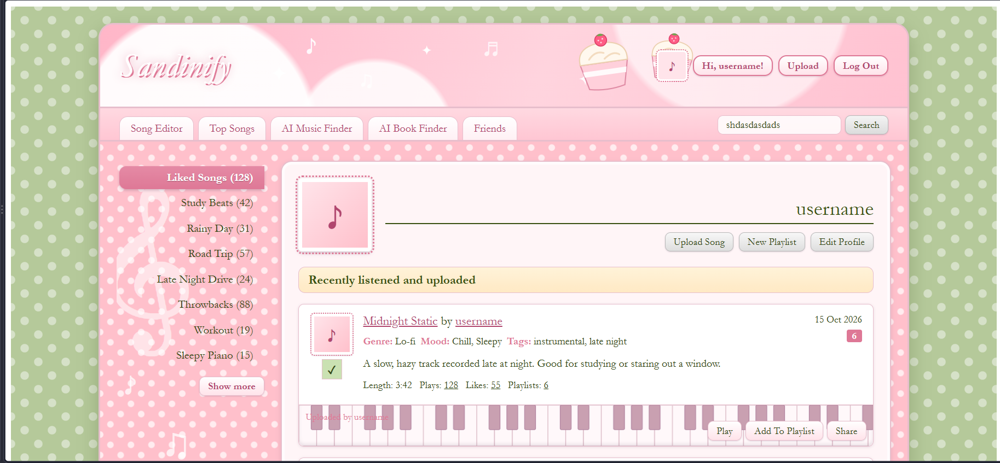
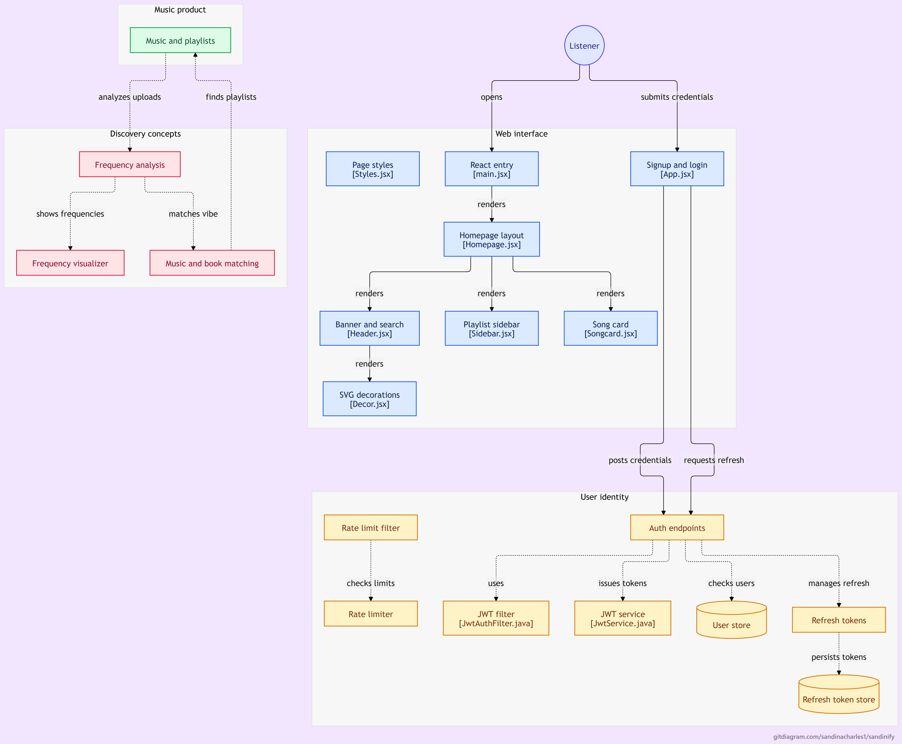

# Sandinify

**Sandinify** is a personal project I'm building to learn how backend systems and system design work. It is a music application heavily inspired by Spotify, but with a unique twist that lets you analyze the actual frequencies of a song and find matching books!
## Table of Contents
* [Homepage Preview](#homepage-preview)
* [Sandinify User Authentication Section](#sandinify-user-authentication-section)
  * [Features](#features)
  * [Tech Stack](#tech-stack)
  * [API Endpoints](#api-endpoints)
  * [Architecture](#architecture)
    * [Project Structure](#project-structure)
  * [Design Decisions](#design-decisions)
    * [Rate limiter: token bucket](#rate-limiter-token-bucket)
    * [Why Redis?](#why-redis)
    * [Why Lua for atomicity?](#why-lua-for-atomicity)
    * [Why not handle it in Java?](#why-not-handle-it-in-java)
    * [Failure behavior](#failure-behavior)
    * [Authentication](#authentication)
  * [Unit Testing](#testing)
  * [Load Testing and Distributed Tracing](#load-testing-and-distributed-tracing)
    * [Initial results](#initial-results)
  * [Getting Started](#getting-started)
    * [Prerequisites](#prerequisites)
    * [Run](#run)
    * [Run the tests](#run-the-tests)
    * [Run the load test](#run-the-load-test)
  * [What I Learned](#what-i-learned)
* [Sandinify User Song Upload Section](#sandinify-user-song-upload-section)
  * [Upload System Design](#upload-design)
  * [Feature Extraction System Design](#feature-extraction-design)

---
## Homepage Preview


# Sandinify User Authentication Section

A Spring Boot backend for user authentication, built with the scalability and observability practices of a production service: a Redis-backed distributed rate limiter, JWT access and refresh tokens, integration tests, and load testing with distributed tracing.

## Features

- **User identity:** signup, login, and a protected `/api/me` endpoint
- **Token-based auth:** short-lived JWT access tokens and revocable refresh tokens
- **Distributed rate limiting:** token bucket algorithm in Redis, enforced by a servlet filter
- **Observability:** OpenTelemetry spans visualized in Jaeger
- **Load tested:** k6 scripts that exercise every endpoint
- **Containerized:** one command starts the app, PostgreSQL, and Redis

## Tech Stack

| Area | Tools |
|---|---|
| Backend | Java, Spring Boot, Spring Data JPA |
| Database | PostgreSQL |
| Cache / rate limiting | Redis, Lua |
| Auth | JWT (HMAC-SHA256), hashed refresh tokens |
| Testing | JUnit 5, MockMvc, Mockito |
| Load testing / tracing | k6, OpenTelemetry, Jaeger |
| Infrastructure | Docker, Docker Compose |

## API Endpoints

| Method | Endpoint | Description | Success | Errors |
|---|---|---|---|---|
| POST | `/api/signup` | Create an account, returns tokens | 201 | 400 blank fields, 409 username taken |
| POST | `/api/login` | Log in, returns tokens | 200 | 401 invalid credentials |
| GET | `/api/me` | Current user (requires access token) | 200 | 401 invalid or expired token |
| POST | `/api/refresh` | Exchange a refresh token for a new access token | 200 | 401 session expired |
| POST | `/api/logout` | Revoke a refresh token | 200 | |

Any endpoint can return **429** when the caller exceeds the rate limit.

## Architecture

```
Request
   |
   v
RateLimitFilter ----> RateLimiterService ----> Redis (Lua token bucket)
   |
   v
JwtAuthFilter (verifies access token on protected routes)
   |
   +--> auth.api.AuthController ----> Auth Services ----> Repositories ----> PostgreSQL
   |
   +--> songs.api.SongUploadController ----> S3StorageService + SongRepository ----> AWS S3 + PostgreSQL
```

### Project Structure

| File | Purpose |
|---|---|
| `RateLimiterService.java` | Token bucket logic, executed as an atomic Lua script in Redis |
| `RateLimitFilter.java` | Runs first on every request; identifies the client by IP and blocks when over the limit |
| `auth/api/AuthController.java` | Authentication REST endpoints; validates input and returns the appropriate HTTP status |
| `songs/api/SongUploadController.java` | Uploads a song to S3 and saves its title, artist, S3 URL, and optional genre, mood, and tags |
| `songs/Song.java` / `songs/SongRepository.java` | JPA mapping and repository for song metadata in PostgreSQL |
| `User.java` / `UserRepository.java` | JPA entity and repository for the users table |
| `RefreshToken.java` / `RefreshTokenRepository.java` / `RefreshTokenService.java` | Refresh token persistence, plus create, hash, validate, and revoke |
| `JwtService.java` | Creates and verifies signed JWT access tokens |
| `JwtAuthFilter.java` | Verifies the access token on protected routes |
| `SandinifyApplicationTests.java` | Integration test suite |
| `loadtest.js` | k6 load test |

Hibernate's `ddl-auto=update` creates or updates the mapped PostgreSQL tables, including `songs`, when the application starts. Docker Compose provisions the PostgreSQL database itself (`sandinify`); when running against a separately installed PostgreSQL server, create that database first.

## Design Decisions

### Rate limiter: token bucket

Each client gets a bucket of tokens. Every request costs one token, and tokens refill at a steady rate. The refill is calculated lazily when a request arrives, so there is no background timer. An empty bucket means the request is rejected with a `429`.

**Why token bucket?** Real traffic is bursty. Token bucket allows short bursts up to the bucket's capacity while still capping the average rate over time. It stores only two values per client (tokens and last timestamp), and it avoids the boundary problem of fixed windows.

### Why Redis?

- State is **shared across app instances**, so counts stay correct when the service scales out
- In-memory and fast, which matters because the check runs on every request
- Built-in **TTL/expiry** cleans up idle buckets automatically
- Avoids hitting the main database on every request
- Tradeoff: one extra network round trip per request

### Why Lua for atomicity?

Redis executes commands one at a time, but a rate limit check has several steps: read the bucket, refill it, decide, write it back. Another request could slip in between those steps and both would see the same token count. A Lua script runs as a single unit inside Redis, so the whole check-and-update cannot be interleaved. It also takes one round trip instead of several and uses Redis's own clock, so all app servers agree on the time.

**Tradeoffs:** The script is a string, so it is harder to read, test, and debug. A long script would block Redis, so this one is kept short.

### Why not handle it in Java?

Java locks like `synchronized` only protect a single JVM. With multiple server instances, each has its own lock and none can see the others. Since Sandinify is designed like a scalable service, the coordination has to live outside the app, in Redis.

### Failure behavior

If Redis is unavailable, the filter **fails open** and lets the request through, since blocking all users because of a limiter outage is worse than briefly allowing extra traffic.

### Authentication

- **Access tokens** are short-lived JWTs, signed with HMAC-SHA256 so tampering is detected.
- **Refresh tokens** are long-lived, stored hashed in the database, and revocable. Logging out invalidates the token so it can no longer be used to refresh.
- Login returns the same error for a wrong password and an unknown user, so attackers cannot discover which usernames exist.
- Passwords are hashed, never stored in plain text.

## Testing

`SandinifyApplicationTests` contains **12 integration tests** that send requests through the full stack with `MockMvc`:

1. Signup succeeds and returns tokens
2. Duplicate signup returns 409
3. Blank fields return 400
4. Login with correct credentials returns tokens
5. Login with wrong password returns 401
6. Login with unknown user returns 401
7. `/me` with a valid token returns 200
8. `/me` with no token returns 401
9. `/me` with a tampered token returns 401
10. Refresh with a valid refresh token returns a new access token
11. Refresh with a fake token returns 401
12. After logout, the refresh token is rejected

The suite uses `@Transactional` so each test's database changes are rolled back, a test-only JWT secret, and a mocked rate limiter so the tests do not depend on Redis.

## Load Testing and Distributed Tracing

Load tests are written in **k6** (`loadtest.js`). The setup creates a test user, then each endpoint (signup, login, `/me`, refresh) is exercised in its own function to keep scenarios decoupled. Password hashing is separated into its own step so its cost can be measured on its own.

Key methods are annotated with OpenTelemetry's `@WithSpan`, which automatically records how long each one takes. The traces are exported to **Jaeger**, so a slow request can be broken down into its parts the way an on-call engineer would debug it.

### Initial results

| Scenario | Result |
|---|---|
| Rate limiter | 5,887 of 6,000 requests sent in rapid bursts were rejected with 429, as expected once the bucket emptied |
| Login | 100% success |
| Signup | 100% success |
| `/me` (access token check) | 100% success |
| Refresh | 100% success |

<p align="center">
  
</p>

<table>
  <tr>
    <td></td>
    <td></td>
  </tr>
  <tr>
    <td></td>
    <td></td>
  </tr>
  <tr>
    <td></td>
    <td></td>
  </tr>
</table>


## Getting Started

### Prerequisites

- Docker and Docker Compose

### Run

```bash
git clone https://github.com/<your-username>/sandinify.git
cd sandinify
docker compose up --build
```

Docker Compose starts the Spring Boot app, PostgreSQL, and Redis. The Dockerfile packages the app and downloads the OpenTelemetry Java agent for the JVM. Database credentials and the JWT secret are read from environment variables, never hardcoded.

### Run the tests

```bash
./mvnw test
```

### Run the load test

```bash
k6 run loadtest.js
```

## What I Learned

While writing the integration tests, every test was failing and the cause was not obvious. Instead of trying random fixes, I narrowed the problem down: since all tests failed, I suspected shared configuration rather than individual logic. I confirmed the app worked outside the test environment by creating an account manually, which isolated the issue to the test setup. Reading the logs more carefully showed that the test environment was not loading configuration properties correctly and that the JWT secret property was referenced with the wrong case. The main lesson was to gather evidence and change my approach when something isn't working, instead of repeating the same fix.


# Sandinify User Song Upload Section
## Upload Design


## Feature Extraction Design

